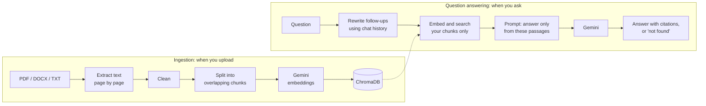

# RAG AI Knowledge Assistant

Upload your PDF, Word and text documents, then ask questions about them in plain language. The app finds the most relevant passages and uses Google Gemini to answer **only from your documents**, showing the file and page each fact came from. When your documents don't contain the answer, it says so instead of making one up.

Built with React, FastAPI, LangChain, ChromaDB and Google Gemini, using free tools and free tiers only.

## Features

- **Accounts:** register and log in (JWT tokens, bcrypt-hashed passwords). Each user's documents and chats are private.
- **Document library:** drag-and-drop upload of PDF, DOCX and TXT files with progress; type, size, content and duplicate checks; delete with confirmation.
- **Processing pipeline:** text extraction page by page → cleaning → overlapping chunks → Gemini embeddings → ChromaDB, with a clear reason when a file fails (for example, a scanned PDF with no text).
- **Grounded answers with citations:** every answer links its facts to numbered source cards (file name, page number, quoted passage).
- **Honest "not found":** if the retrieved passages don't answer the question, the app says so instead of guessing.
- **Follow-up questions:** "Can I use it during probation?" is rewritten using the chat history before searching, and the UI shows how the question was understood.
- **Conversation history:** saved chats you can reopen or delete.
- **Responsive and accessible UI:** works on phones, keyboard-friendly, and status is never shown by color alone.

## Screenshots

| Chat with sources | Documents |
|---|---|
|  |  |
| **Not in your documents** | **Log in** |
|  |  |

## How it works



1. **Ingestion:** the backend extracts text from each page, cleans it, splits it into chunks of about 1,000 characters (with 200 characters of overlap so facts aren't cut in half), turns each chunk into an embedding with Gemini, and stores it in ChromaDB tagged with the user, document, file name and page.
2. **Retrieval:** a question is embedded the same way, and ChromaDB returns the 5 most similar chunks, filtered to the current user's documents.
3. **Generation:** Gemini receives only those numbered passages, with rules: use only this context, cite passages as [1], [2], and reply `NOT_FOUND` if the context isn't enough.

More detail, with sequence and database diagrams: [docs/ARCHITECTURE.md](docs/ARCHITECTURE.md).

## Tech stack

| Layer | Technology | Why |
|---|---|---|
| Frontend | React 19, Vite, Tailwind CSS 4, React Router, Axios | Fast dev server, utility-first styling, client-side routing, interceptors for the login token |
| Backend | Python 3.12, FastAPI, Pydantic, SQLAlchemy | Request validation and Swagger docs come from type hints; the ORM keeps a later move to PostgreSQL simple |
| AI / RAG | LangChain, Google Gemini (chat and embeddings), ChromaDB | LangChain for splitting and model/vector-store wrappers; Gemini has a free tier; ChromaDB runs inside the app with no server |
| Storage | SQLite, ChromaDB, local file storage | No database server to install or pay for |
| Auth | JWT (PyJWT), bcrypt | Stateless tokens for a single-page app; salted password hashes |
| Testing | pytest, Vitest, React Testing Library, Postman | Gemini is mocked in tests, so they're free and run offline |

## Run it locally (Windows / PowerShell)

**You need:** Python 3.12, Node.js 20+, and a free Gemini API key from [Google AI Studio](https://aistudio.google.com/apikey). Login works without the key; uploading and asking need it.

**1. Backend** (terminal 1)
```powershell
cd backend
py -3.12 -m venv .venv
.venv\Scripts\Activate.ps1
pip install -r requirements.txt
copy .env.example .env
py -3.12 -c "import secrets; print(secrets.token_urlsafe(48))"   # paste the result as JWT_SECRET_KEY in .env
# also put your key in .env as GEMINI_API_KEY
uvicorn app.main:app --reload
```
The API runs at http://localhost:8000, with interactive docs at http://localhost:8000/docs.

**2. Frontend** (terminal 2)
```powershell
cd frontend
npm install
npm run dev
```
Open http://localhost:5173, create an account (any valid-looking email works, since no emails are sent), upload a document and ask a question.

> The Gemini free tier is rate-limited, and Google may use free-tier requests to improve its products. Only upload documents that are safe to share.

### Configuration

Backend settings live in `backend/.env` (template: [backend/.env.example](backend/.env.example)). Never commit `.env`.

| Variable | Default | Purpose |
|---|---|---|
| `JWT_SECRET_KEY` | *(required)* | Signs login tokens. At least 32 characters; the server refuses to start without it |
| `GEMINI_API_KEY` | *(needed for AI)* | Google AI Studio key for embeddings and answers |
| `GEMINI_CHAT_MODEL` | `gemini-2.5-flash` | Model that writes answers |
| `GEMINI_EMBEDDING_MODEL` | `models/gemini-embedding-001` | Model that creates embeddings. If you change it, re-upload your documents |
| `CHUNK_SIZE` / `CHUNK_OVERLAP` | `1000` / `200` | Chunk length and overlap, in characters |
| `TOP_K` | `5` | Chunks retrieved per question |
| `MAX_UPLOAD_MB` | `10` | Upload size limit |
| `JWT_EXPIRE_MINUTES` | `60` | How long a login lasts |
| `CORS_ORIGINS` | `http://localhost:5173` | Frontend URLs allowed to call the API (comma-separated) |
| `DATA_DIR` / `DATABASE_URL` | `backend/data`, SQLite | Where files, vectors and the database are stored |

Frontend settings (optional, in `frontend/.env.local`): `VITE_API_BASE_URL` (default `http://localhost:8000/api`) and `VITE_MAX_UPLOAD_MB` (default `10`).

## Deployment

The app is deployed free on **Render**: the backend as a Web Service and the frontend as a Static Site, both rebuilt automatically on every push to `main`, after GitHub Actions has run the tests. Step-by-step guide: [docs/DEPLOYMENT.md](docs/DEPLOYMENT.md).

## Testing

| Suite | Command | What it covers |
|---|---|---|
| Backend: 74 tests | `cd backend; .venv\Scripts\Activate.ps1; pytest` | Every API endpoint, validation errors, user isolation, chunking and page numbers, grounding rules, follow-ups, Gemini rate limits, login-attempt limiting, safe tokens after a data reset, recovery after a crash, API docs |
| Frontend: 41 tests | `cd frontend; npm test` | Login and registration, route protection, the API client's token handling, Documents page (upload, validation, delete), Chat page (answers, citations, "not found", retry) |
| API: 21 Postman requests | Import [docs/postman/RAG_Knowledge_Assistant.postman_collection.json](docs/postman/RAG_Knowledge_Assistant.postman_collection.json) and run the collection | The full flow against a running server, including error cases. It cleans up after itself |

Tests never call the real Gemini API: embeddings use a deterministic fake, and the chat model is replaced with scripted answers. For Postman, set *Settings → General → Working directory* to the project folder, so the upload requests can find their test files.

## API

Full interactive documentation: **http://localhost:8000/docs** (Swagger UI, with an *Authorize* button for the token).

| Method | Endpoint | Purpose |
|---|---|---|
| GET | `/api/health` | API and database status |
| POST | `/api/auth/register` | Create an account |
| POST | `/api/auth/login` | Get a JWT access token |
| GET | `/api/auth/me` | Current user |
| POST | `/api/documents` | Upload and process a document |
| GET | `/api/documents` | List my documents |
| GET / DELETE | `/api/documents/{id}` | Read or delete a document (file and vectors too) |
| POST | `/api/chat/ask` | Ask a question; omit `conversation_id` to start a new chat |
| GET | `/api/conversations` | List my conversations |
| GET | `/api/conversations/{id}/messages` | Conversation history with sources |
| DELETE | `/api/conversations/{id}` | Delete a conversation |

Errors come back as `{"detail": "..."}` with a meaningful status code: 400, 401, 404, 409, 413, 429 (Gemini busy), 502 (Gemini failed) or 503 (key missing or database down). Validation errors (422) use FastAPI's standard format, where `detail` is a list of problems.

## Project structure

```
backend/
  app/
    api/          routes (thin), dependencies (DB session, current user), documented error responses
    core/         settings, JWT and password hashing, logging, error types
    database/     SQLAlchemy engine and sessions
    models/       tables: User, Document, Conversation, Message
    schemas/      Pydantic request and response models
    services/     business logic and the RAG pipeline: ingestion, vector store, retrieval, chat, LLM
  tests/          pytest suite (Gemini mocked)
frontend/src/
  pages/          Login, Register, Documents, Chat
  components/     ui/ (Button, TextField, Alert, ConfirmDialog...), layout/, documents/, chat/
  services/       Axios client and API calls (the only place that talks to the backend)
  context/        login state (AuthContext) and toasts
docs/             PRD, architecture, UI/UX spec, roadmap, Postman collection
```

## Design decisions and trade-offs

- **Grounding over fluency.** A strict prompt, a low temperature (0.2), a `NOT_FOUND` marker, and skipping the model entirely when nothing relevant is retrieved. Fewer answers, but no invented ones.
- **Data isolation in two places.** Every database query for documents and conversations filters by the user's ID, and every ChromaDB search filters on the same ID in chunk metadata. Other users' resources return 404, so their IDs aren't revealed.
- **Fail fast, fail clearly.** The server won't start without a strong JWT secret. Uploads are checked by extension *and* file content (magic bytes). Gemini errors become specific messages (429 busy, 502 failed, 503 not configured), not generic 500s.
- **Safe on free hosting.** The free server erases its data on restart, so account IDs get reused. Login tokens carry the account's email as well as its ID, so an old token can't open someone else's new account. Failed logins are limited per IP address (read correctly behind Render's proxy) and email.
- **Simple storage first.** SQLite and embedded ChromaDB need no servers and cost nothing. SQLAlchemy keeps a move to PostgreSQL to a config change.
- **Token in localStorage.** Simple for a single-page app. The trade-off is that JavaScript can read it (XSS risk), which is limited because React escapes all output and the app never injects raw HTML.

## Known limitations

- Scanned (image-only) PDFs can't be read: there's no OCR, and they fail with a clear message.
- Documents are processed during the upload request, so very large files make the upload slow. A background job queue is the next step.
- Failed logins are limited per IP address and email (5 per 15 minutes), in memory, which works for a single server. There are no refresh tokens; users log in again after 60 minutes.
- On Render's free plan the backend sleeps when idle, so the first request after a break takes up to a minute (the UI explains the wait).
- SQLite and embedded ChromaDB tie the backend to a single server. On free hosting without a persistent disk, data resets on restart.

## Roadmap

The MVP is complete and ready to deploy (GitHub Actions runs every test on each push). Next is Phase 2, advanced RAG: streaming answers, choosing which documents to search, hybrid search (BM25 + vectors), reranking, context compression, and retrieval evaluation with Recall@K and MRR. Full plan: [docs/DEVELOPMENT_ROADMAP.md](docs/DEVELOPMENT_ROADMAP.md). Requirements: [docs/PRD.md](docs/PRD.md). UI/UX spec: [docs/UI_UX_DESIGN.md](docs/UI_UX_DESIGN.md).
