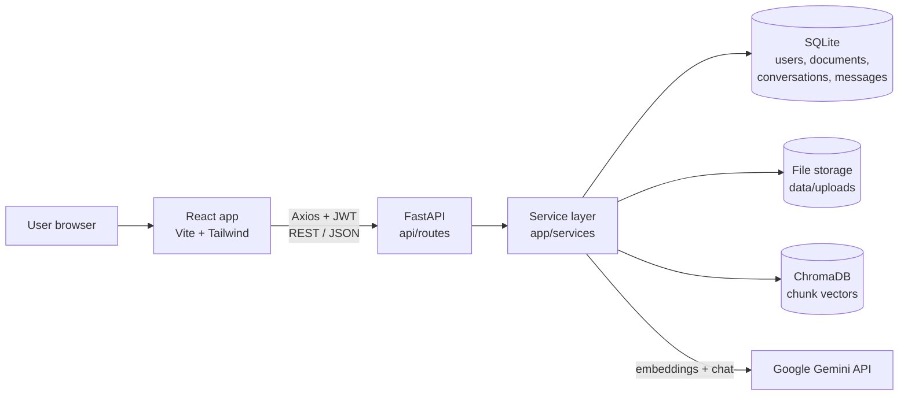
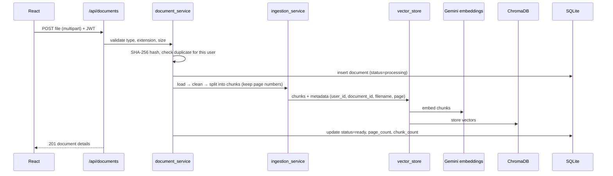
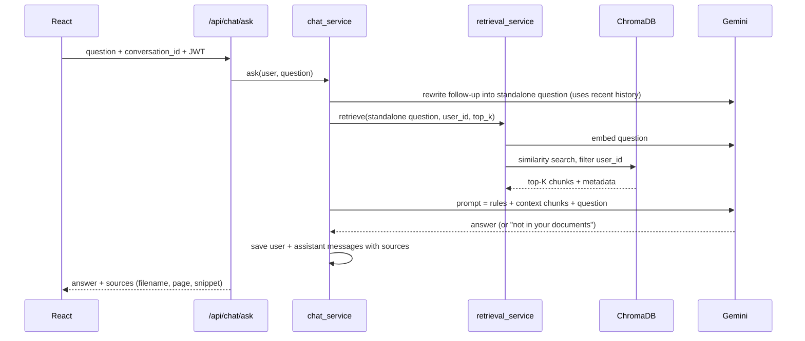
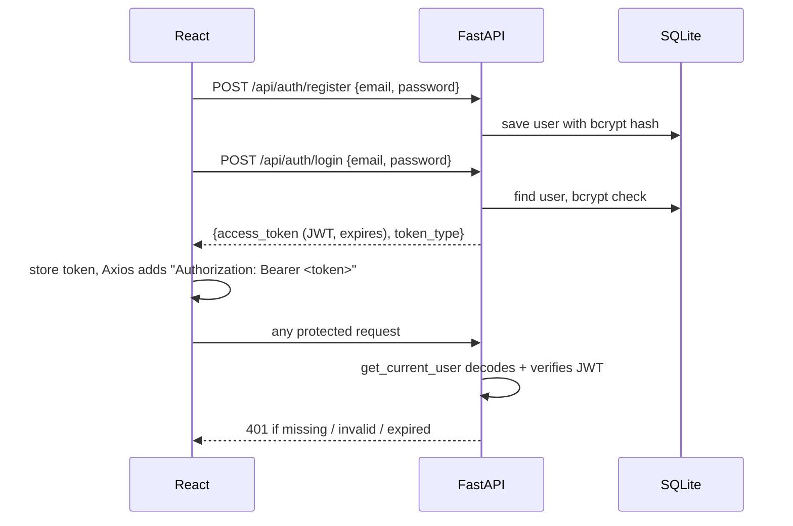
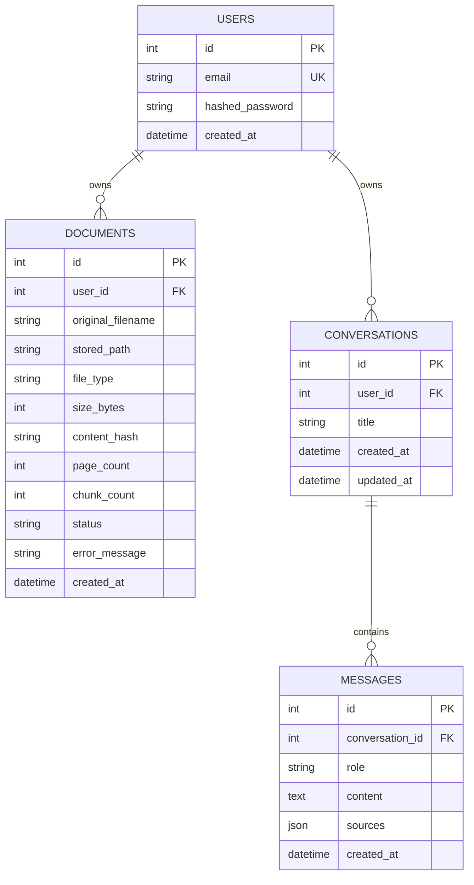
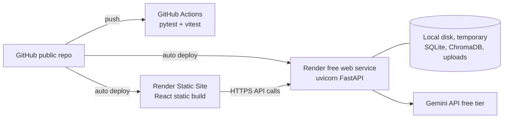

# Architecture

This document describes the target design. Parts are built step by step (see [DEVELOPMENT_ROADMAP.md](DEVELOPMENT_ROADMAP.md)); the roadmap shows what exists today.

## 1. System overview

**Layers and their jobs**

| Layer | Folder | Responsibility |
|---|---|---|
| UI | `frontend/src/pages`, `components` | Show data, collect input. No API details. |
| API client | `frontend/src/services` | Axios calls, attach JWT, handle 401. |
| Routes | `backend/app/api/routes` | Parse request, call a service, return a schema. No business logic. |
| Dependencies | `backend/app/api/deps.py` | DB session per request, current user from JWT. |
| Schemas | `backend/app/schemas` | Pydantic validation of request and response bodies. |
| Services | `backend/app/services` | Business rules and the RAG pipeline. |
| Models | `backend/app/models` | SQLAlchemy table definitions. |
| Database | `backend/app/database` | Engine, session factory. |
| Core | `backend/app/core` | Settings, security (JWT, hashing), logging, error types. |

## 2. Document ingestion flow

## 3. Question answering flow

**Grounding rule.** The prompt tells Gemini to answer only from the given context and to reply with a fixed "I couldn't find this in your documents" message when the context is not enough. If retrieval returns no chunks at all, the service returns that message without calling Gemini.

## 4. Authentication flow

**Authorization** is ownership-based: every query adds `user_id == current_user.id`, so a user asking for another user's document gets 404 (not 403, so the app doesn't reveal that the ID exists).

## 5. Database design

- `documents` has a unique constraint on `(user_id, content_hash)`, so a user can't upload the same file twice (two different users can).
- `messages.sources` stores the citations as JSON, so old answers still show their sources.
- ChromaDB holds one collection of chunks; each chunk's metadata is `user_id`, `document_id`, `filename`, `page`, `chunk_index`. The Chroma chunk IDs are `{document_id}-{chunk_index}`, so deleting a document deletes its vectors by `document_id`.

**Why SQLite + ChromaDB:** SQLite needs no server and fits a single-instance portfolio app; SQLAlchemy makes moving to PostgreSQL a config change. ChromaDB runs embedded (no separate server), persists to disk, and supports metadata filters, which per-user isolation depends on.

## 6. API overview

| Method | Path | Auth | Purpose |
|---|---|---|---|
| GET | `/api/health` | No | App and database status |
| POST | `/api/auth/register` | No | Create account |
| POST | `/api/auth/login` | No | Get JWT |
| GET | `/api/auth/me` | Yes | Current user |
| POST | `/api/documents` | Yes | Upload and process a document |
| GET | `/api/documents` | Yes | List my documents |
| GET | `/api/documents/{id}` | Yes | Document details |
| DELETE | `/api/documents/{id}` | Yes | Delete document, file and vectors |
| POST | `/api/chat/ask` | Yes | Ask a question, get answer + sources |
| GET | `/api/conversations` | Yes | List my conversations |
| GET | `/api/conversations/{id}/messages` | Yes | Conversation history |
| DELETE | `/api/conversations/{id}` | Yes | Delete a conversation |

Errors return `{"detail": "..."}` (for 422 validation errors, `detail` is a list of problems) with a suitable status: 400 bad input, 401 not logged in, 404 not found or not yours, 409 duplicate, 413 file too large, 422 validation error, 429 Gemini rate limit, 500 unexpected, 502 Gemini failed, 503 database down or Gemini key missing.

## 7. Deployment (planned, free tiers only)

Secrets (`GEMINI_API_KEY`, `JWT_SECRET_KEY`) are set in the Render dashboard, never in the repo. The frontend gets the API URL from `VITE_API_BASE_URL`.

**Free tier trade-offs:** Render free sleeps after about 15 minutes idle (slow first request, so the UI shows a "waking up" hint) and its disk is temporary, so data resets on restart or redeploy. Tokens carry the account's email as well as its ID, so a token from before a reset can't log into a new account that reuses the ID. Gemini's free tier has per-minute and per-day request limits, so embeddings are sent in batches and 429 errors become a friendly "try again shortly" message.

## 8. Known limitations of this design
- Processing runs inside the upload request, so very large files make the request slow (a background job queue is a later improvement).
- SQLite and embedded ChromaDB tie the backend to one server instance; scaling out needs PostgreSQL and a client/server vector database.
- No refresh tokens: when the JWT expires, the user logs in again.
- On the free hosting tier, stored data is lost on restart (no persistent disk). The fix is a free managed PostgreSQL plus a hosted vector store or a paid disk; both are out of scope for now.
