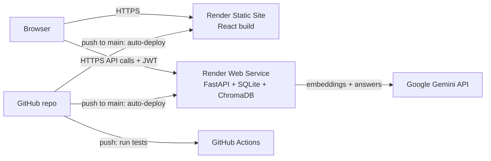

# Deploying to Render (free)

The app is deployed as **two free Render services** built from the same GitHub repository:

| Part | Render service type | Root directory | What it does |
|---|---|---|---|
| Backend (FastAPI) | **Web Service**, Free instance | `backend` | Runs the API: `https://<your-api-name>.onrender.com` |
| Frontend (React) | **Static Site** | `frontend` | Serves the built React files: `https://<your-web-name>.onrender.com` |



## What the free plan means

Check Render's pricing page for current limits. When this was written:

- **The backend sleeps** after about 15 minutes without visitors. The next request wakes it and can take **up to a minute**; the app shows a "server is waking up" message.
- **No permanent disk.** Accounts, documents and chats are **erased whenever the backend restarts**: after sleeping, redeploying or changing a setting. That's fine for a portfolio demo, and the README says so. Login tokens from before a reset are rejected safely.
- **512 MB of memory.** The backend uses about 160 MB when idle. Keep uploads small (the limit is 10 MB).

---

## Step 0: Put the code on GitHub

1. **Commit everything from the project root.** Running `git add .` inside `backend/` only adds that folder.
   ```powershell
   cd "C:\Users\rakes\Desktop\Rag Application"
   git add .
   git commit -m "Prepare for deployment"
   git status        # should say "nothing to commit"
   ```
2. On github.com, click **New repository**: name it `rag-knowledge-assistant`, make it **Public**, and **don't** add a README, .gitignore or license (the project already has them). Click **Create repository**.
3. Push your code (replace `<your-username>`):
   ```powershell
   git branch -M main
   git remote add origin https://github.com/<your-username>/rag-knowledge-assistant.git
   git push -u origin main
   ```
4. Open the repository's **Actions** tab. The **CI** workflow runs all backend and frontend tests; wait for the green tick.

`.env`, the database and uploaded files are in `.gitignore`, so your keys are never pushed.

## Step 1: Deploy the backend (Web Service)

1. Go to https://render.com and sign up with **GitHub**.
2. Click **New → Web Service**, then choose your `rag-knowledge-assistant` repository (allow Render to access it if asked).
3. Fill in the form:

   | Field | Value |
   |---|---|
   | Name | `rag-assistant-api` (any name; it becomes part of the URL) |
   | Region | The one closest to you (e.g. Singapore) |
   | Branch | `main` |
   | Root Directory | `backend` |
   | Language / Runtime | `Python 3` |
   | Build Command | `pip install -r requirements.txt` |
   | Start Command | `uvicorn app.main:app --host 0.0.0.0 --port $PORT` |
   | Instance Type | **Free** |

4. Under **Environment Variables**, add:

   | Key | Value | Why |
   |---|---|---|
   | `PYTHON_VERSION` | `3.12.10` | Same Python as your laptop |
   | `JWT_SECRET_KEY` | A **new** random value (see below) | Signs login tokens. Use a different one from your local `.env` |
   | `GEMINI_API_KEY` | Your Google AI Studio key | For embeddings and answers |
   | `APP_ENV` | `production` | Shown by `/api/health` |
   | `FORWARDED_ALLOW_IPS` | `*` | Render sits in front of the app as a proxy. This lets the app see each visitor's real IP address, which the login-attempt limit needs |
   | `CORS_ORIGINS` | `http://localhost:5173` | Temporary. You'll set the real frontend URL in Step 3 |

   To generate a new JWT secret on your laptop:
   ```powershell
   py -3.12 -c "import secrets; print(secrets.token_urlsafe(48))"
   ```
5. If there's a **Health Check Path** field (under *Advanced*, or later in *Settings*), set it to `/api/health`.
6. Click **Create Web Service**. The first build takes several minutes, because ChromaDB is a large package. It's ready when the logs show `Startup complete (env=production)` and the page shows your URL.
7. Test it in the browser:
   - `https://<your-api-name>.onrender.com/api/health` should show `{"status":"ok","database":"ok","environment":"production"}`
   - `https://<your-api-name>.onrender.com/docs` shows the Swagger page.

## Step 2: Deploy the frontend (Static Site)

1. Click **New → Static Site** and choose the same repository.
2. Fill in the form:

   | Field | Value |
   |---|---|
   | Name | `rag-assistant-web` |
   | Branch | `main` |
   | Root Directory | `frontend` |
   | Build Command | `npm ci && npm run build` |
   | Publish Directory | `dist` |

3. Under **Environment Variables**, add:

   | Key | Value |
   |---|---|
   | `NODE_VERSION` | `24` (same as your laptop: its npm 11 wrote `package-lock.json`, and npm 10 from Node 22 rejects it) |
   | `VITE_API_BASE_URL` | `https://<your-api-name>.onrender.com/api` (your backend URL from Step 1, plus `/api`, no `/` at the end) |

4. Click **Create Static Site** and wait for the build.
5. Open the site's **Redirects/Rewrites** settings and add this rule. Without it, refreshing a page like `/chat` shows "Not Found", because those pages exist only inside React, not as files:

   | Source | Destination | Action |
   |---|---|---|
   | `/*` | `/index.html` | Rewrite |

## Step 3: Let the frontend call the backend (CORS)

Browsers block a website from calling an API on another address unless the API allows it.

1. Open the **backend** service → **Environment**.
2. Change `CORS_ORIGINS` to your frontend URL, for example `https://rag-assistant-web.onrender.com`. To keep local development working against the live API too, add it after a comma: `https://rag-assistant-web.onrender.com,http://localhost:5173`
3. Save. The backend redeploys by itself. Remember that this restart also erases its data.

## Step 4: Test the live app

Open the frontend URL and check:

- [ ] You can register and log in (the first request may take up to a minute while the backend wakes up).
- [ ] Uploading a small PDF or TXT shows **Ready**.
- [ ] A question about it gets an answer with numbered sources.
- [ ] A question it can't answer shows "I couldn't find this in your documents."
- [ ] Refreshing the page on `/chat` or `/documents` still works.
- [ ] It works on your phone.

To test the API itself, run the Postman collection with the `baseUrl` variable set to `https://<your-api-name>.onrender.com/api`.

Finally, put the live link at the top of the README and in your resume.

## Updating the live app

- **Code changes:** push to `main`. GitHub runs the tests, and Render rebuilds both services automatically.
- **Backend environment variables:** saving them redeploys the backend.
- **Frontend environment variables** (`VITE_...`): these are copied into the files at build time, so after changing one, choose **Manual Deploy → Clear build cache & deploy** on the static site.

## Troubleshooting

| What you see | What to do |
|---|---|
| Backend build fails on the Python version | Check that `PYTHON_VERSION` is `3.12.10` |
| Logs say `JWT_SECRET_KEY ... must be at least 32 characters` | Add or fix `JWT_SECRET_KEY` on the backend |
| The website says "Can't reach the server…" | The backend may be asleep: wait a minute and try again. Otherwise `VITE_API_BASE_URL` is wrong (it must start with `https://` and end with `/api`): fix it, then *Clear build cache & deploy* |
| The browser console (F12) shows a **CORS** error | `CORS_ORIGINS` on the backend must exactly match the frontend URL, including `https://` |
| Refreshing `/chat` shows "Not Found" | Add the rewrite rule from Step 2 |
| "The AI service isn't set up yet…" | `GEMINI_API_KEY` is missing on the backend |
| "The AI service failed to respond…" | Read the backend **Logs**. A model name in `GEMINI_CHAT_MODEL` / `GEMINI_EMBEDDING_MODEL` may need updating |
| You were logged out, and your documents are gone | The backend restarted (free plan): register again |
| Logs mention running out of memory | Use smaller files; the free instance has 512 MB |
